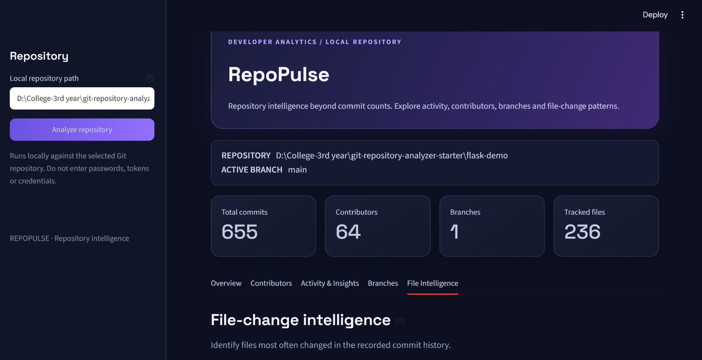
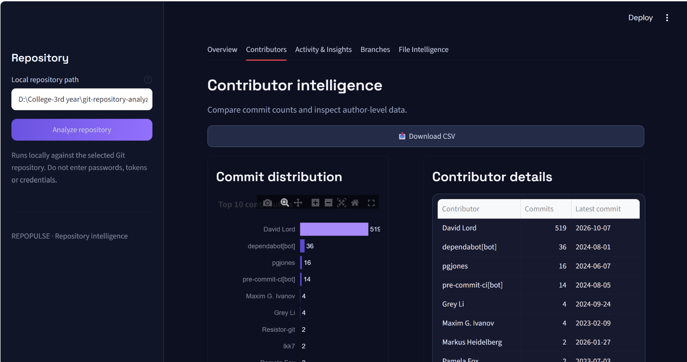
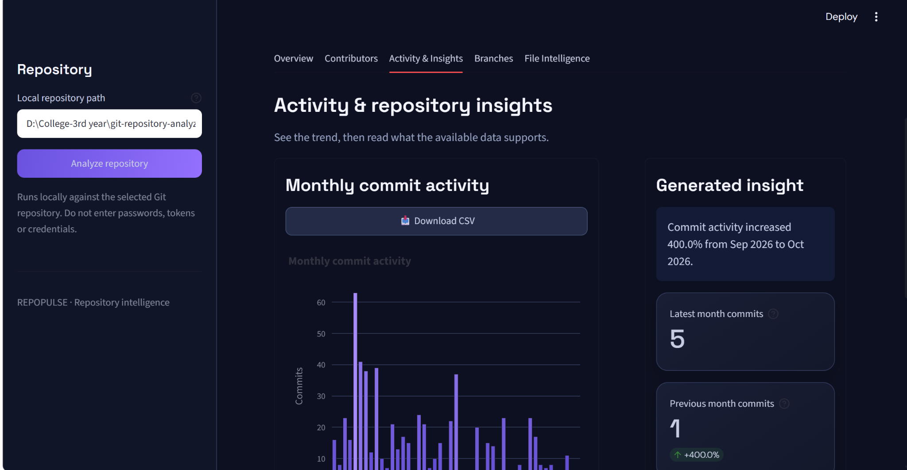
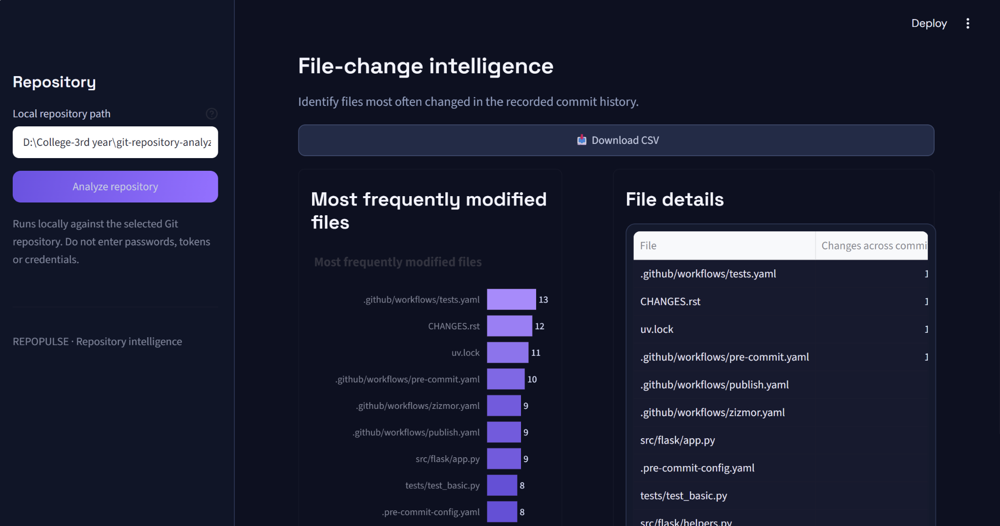
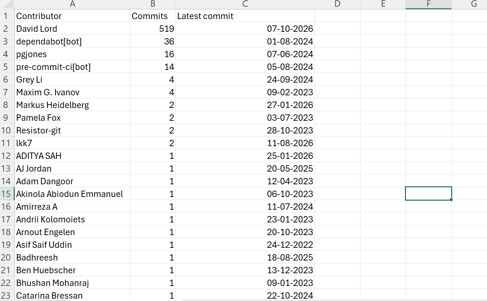
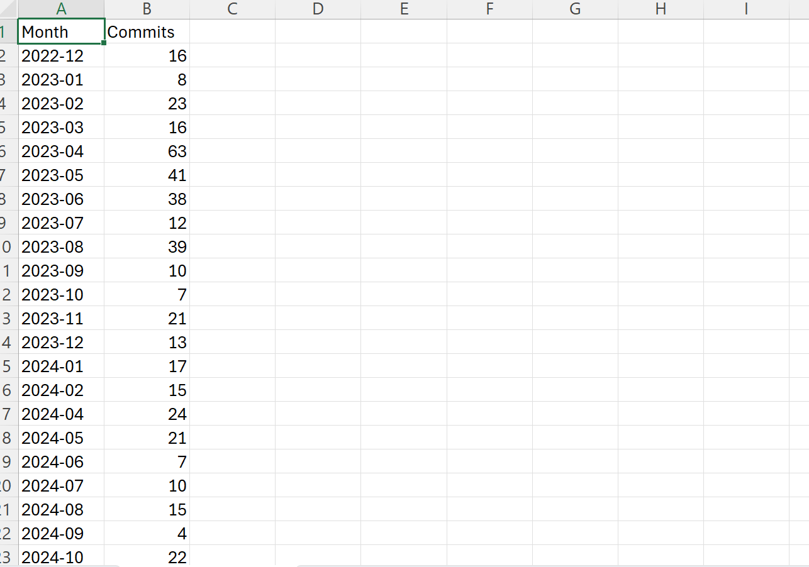
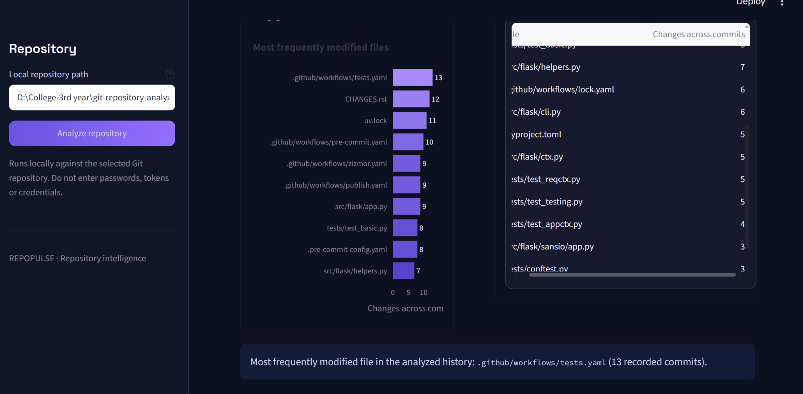
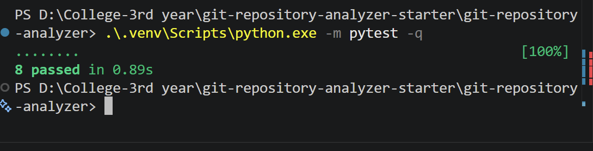

# RepoPulse — Git Repository Analyzer

RepoPulse is a local Python dashboard for exploring the Git history available in a repository. It summarizes commits, contributors, branches, monthly activity, and frequently modified files.

## Features

- **Repository overview:** summary metrics, current branch, commit timeline, and busiest recorded month.
- **Contributor intelligence:** contributor commit counts, chart, and CSV export.
- **Activity & insights:** monthly commit activity, generated insight summary, and CSV export.
- **Branch explorer:** information about branches available in the local repository.
- **File intelligence:** frequently modified files and CSV export.
- **Dark dashboard UI:** consistent chart, table, and CSV download-button styling.
- **Automated tests:** tests for selected repository-analysis and insight helper functions.

## Tech stack

- Python 3.10+
- Streamlit
- Pandas
- Plotly
- GitPython
- Pytest

## Requirements

- Python 3.10 or newer
- Git installed locally
- Dependencies listed in `requirements.txt`

## Setup

Run the following commands from the project root.

### Windows PowerShell

```powershell
python -m venv .venv
.\.venv\Scripts\Activate.ps1
python -m pip install -r requirements.txt
python -m streamlit run app.py
```

If the virtual environment already exists, run the app directly with:

```powershell
.\.venv\Scripts\python.exe -m streamlit run app.py
```

### macOS / Linux

```bash
python3 -m venv .venv
source .venv/bin/activate
python -m pip install -r requirements.txt
python -m streamlit run app.py
```

## How to use

1. Start the app.
2. In the sidebar, enter the path to a **local Git repository** containing a `.git` directory.
3. Click **Analyze repository**.
4. Explore the Overview, Contributors, Activity & Insights, Branches, and File Intelligence tabs.
5. Use the **Download CSV** button in the relevant tab to export its table.

Example Windows path (replace with your own local repository path):

```text
D:\path\to\your\repository
```

The app analyzes the history available in the selected local clone. A shallow or incomplete clone may not include the full upstream history.

## Screenshots

### Repository overview



### Contributors tab — CSV export



### Activity & Insights tab — CSV export



### File Intelligence tab — CSV export



### CSV exports opened in Excel





### File Intelligence dashboard



### Automated tests

The latest test screenshot supplied for this documentation shows eight tests passing. Re-run the test command locally to confirm the result for the current checkout.



## Testing

From the project root, run:

```powershell
.\.venv\Scripts\python.exe -m pytest -q
```

Or, if the virtual environment is activated:

```bash
pytest -q
```

## Project documentation

The investigation documents are kept separately from this README:

- `docs/architecture.md` — architecture notes.
- `docs/bug-investigation.md` — suggested invalid-repository-path test scenario; record actual results only after running the test.
- `docs/issue-investigation.md` — issue investigation notes.
- `docs/pull-request-investigation.md` — pull-request investigation notes.
- `docs/report-outline.md` — report outline.

These documents describe investigation areas; their presence alone does not prove a bug was reproduced, fixed, or a pull request was merged.

## Limitations

- Analysis is local and does not call the GitHub API.
- Contributor identity is grouped by Git author name, which can vary across commits.
- Branch metrics reflect branches visible to the local repository; remote-only branches may not be listed.
- File frequency is based on commit-level file statistics and is not a measure of lines changed.
- Results depend on the repository history and objects available in the selected clone.

## References

- GitPython documentation: https://gitpython.readthedocs.io/
- Streamlit documentation: https://docs.streamlit.io/
- Git documentation: https://git-scm.com/docs

---

*Open Source Technologies (TE7756) — CA-3 Case Study*
