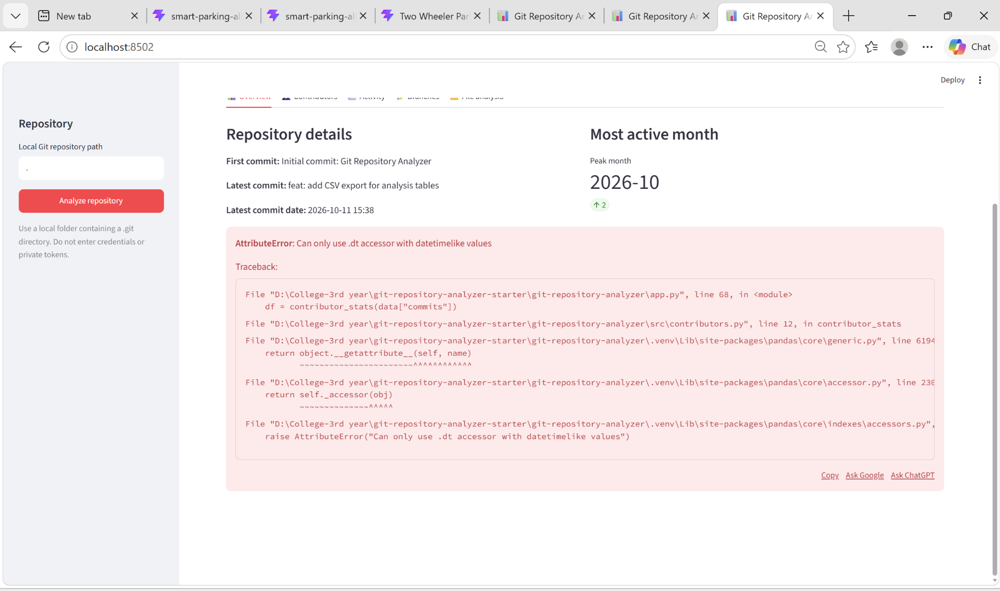
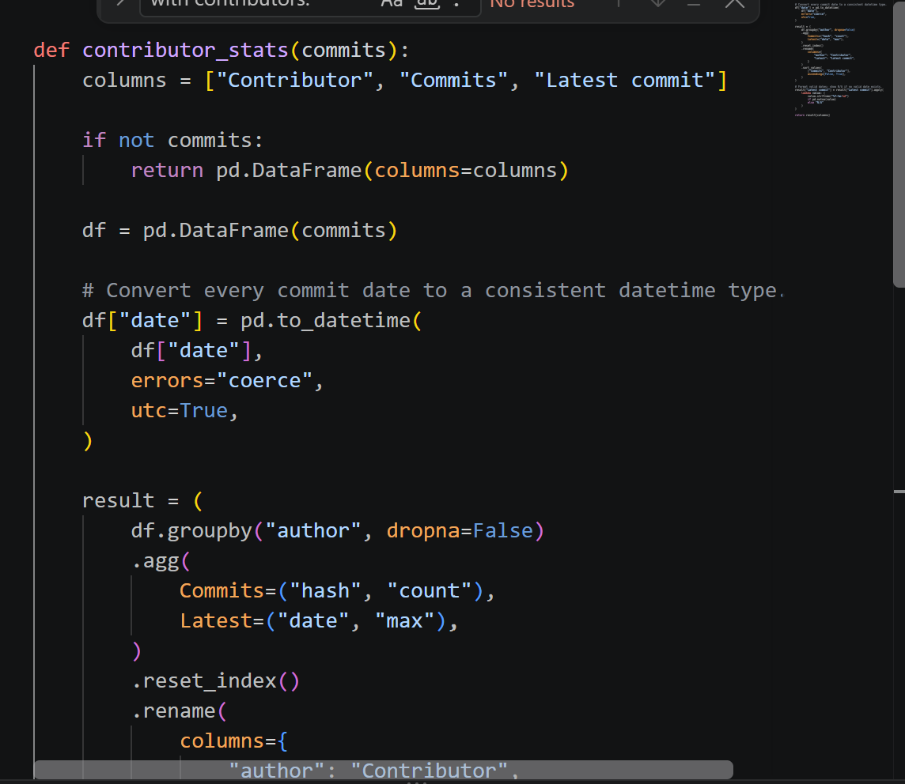
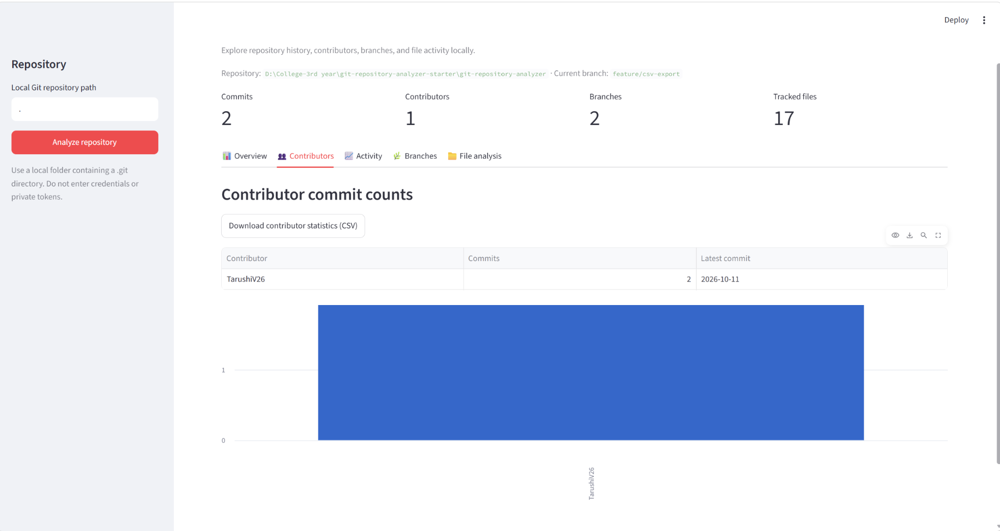
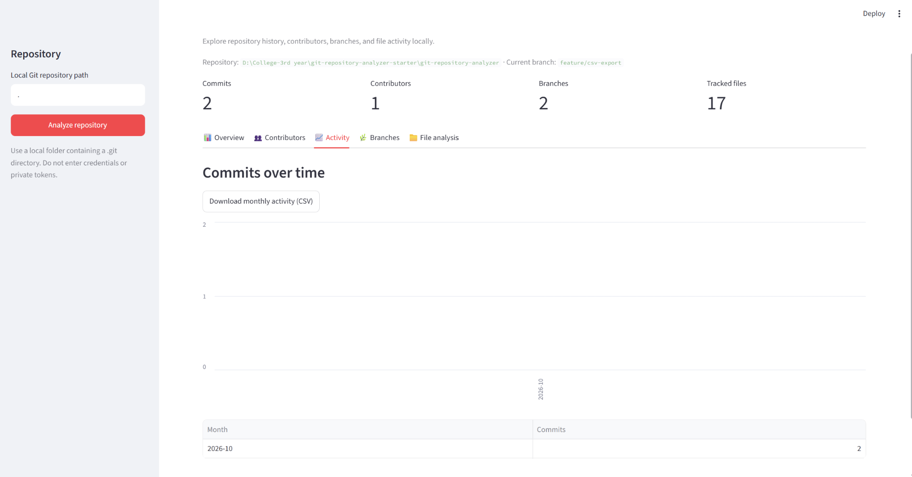
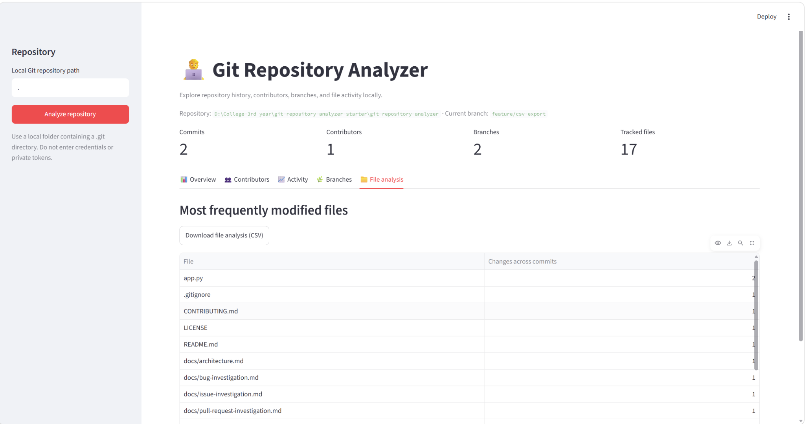
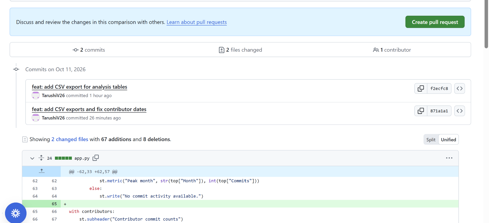

# Bug Investigation — RepoPulse Git Repository Analyzer

> **Standalone investigation document.** This file is separate from the project's main `README.md`. Screenshots used as evidence are stored in the adjacent `screenshots/` folder.

## 1. Purpose

This document records the date-handling error observed in the RepoPulse Git Repository Analyzer when the Contributors section attempted to summarize commit dates.

## 2. Bug summary

**Observed error**

```text
AttributeError: Can only use .dt accessor with datetimelike values
```

The original application screenshot shows the repository overview before the error traceback appears. The traceback points to the call to `contributor_stats(data["commits"])` in `app.py`, with the failure occurring in `src/contributors.py` when Pandas attempts to use the `.dt` accessor.

**User-visible impact:** the Contributors section could fail to render its statistics instead of showing the contributor summary.

### Evidence 1 — Original error



## 3. Technical cause

Pandas' `.dt` accessor is supported only for datetime-like Series. The traceback indicates that the date column used by `contributor_stats()` did not have a datetime-like dtype at the point where its date components were accessed.

Commit records may contain date values that have not yet been normalized to a consistent Pandas datetime dtype. Attempting `.dt` operations on a non-datetime-like column raises the observed `AttributeError`.

## 4. Correction shown in the supplied code evidence

The supplied code screenshot shows the date column being converted before the contributor aggregation:

```python
df["date"] = pd.to_datetime(
    df["date"],
    errors="coerce",
    utc=True,
)
```

This normalizes valid date values to a datetime-aware representation. `errors="coerce"` converts unparseable values to `NaT`, so those rows may need explicit handling if dates are missing or invalid.

### Evidence 2 — Date normalization code



## 5. Screenshots after the change

The supplied dashboard screenshots show the Contributors, Activity, and File Intelligence views with their displayed data and CSV download controls. These screenshots document visible application behavior after the change; they do not prove that every possible date input has been tested.

### Evidence 3 — Contributors dashboard



### Evidence 4 — Activity dashboard



### Evidence 5 — File Intelligence dashboard



## 6. GitHub change evidence

The supplied GitHub comparison screenshot shows commits titled “feat: add CSV export for analysis tables” and “feat: add CSV exports and fix contributor dates”. This supports that a follow-up change was committed; the screenshot alone does not establish that a pull request was merged or approved.

### Evidence 6 — GitHub comparison



## 7. Verification

A later test run shared during the project workflow reported:

```text
........ [100%]
8 passed in 1.75s
```

This is a **previously observed** result, not a claim that the test suite was rerun while preparing this document. Re-run the suite against the final checkout before submission:

```powershell
.\.venv\Scripts\python.exe -m pytest -q
```

## 8. Manual verification checklist

- [ ] Start the dashboard from the project root.
- [ ] Analyze a valid local Git repository.
- [ ] Open the Contributors tab and confirm the `.dt accessor` error no longer appears.
- [ ] Check contributor names, commit counts, and latest commit dates.
- [ ] Download the contributor CSV and verify its columns and values.
- [ ] Open Activity and File Intelligence and check their displayed data and CSV controls.
- [ ] Run the test suite on the final checkout and record the actual output.

## 9. Limitations and reporting accuracy

The evidence documents the observed error, the date-normalization code shown in the supplied screenshot, later dashboard screenshots, and a previously reported test run with eight passing tests. It does not establish that all edge cases are covered. Missing or malformed dates, empty repositories, and unusual commit metadata should be tested if they are in scope.

Do not report the bug as fully resolved for every input case unless the current checkout has been tested. Do not report a pull request as merged or approved unless GitHub shows that status.
